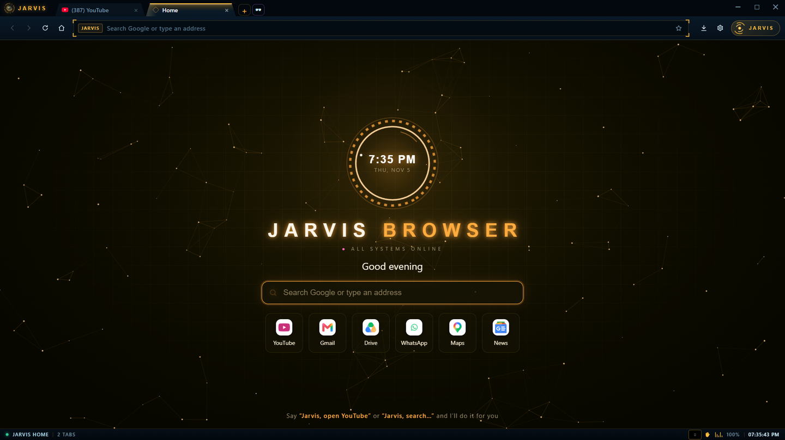
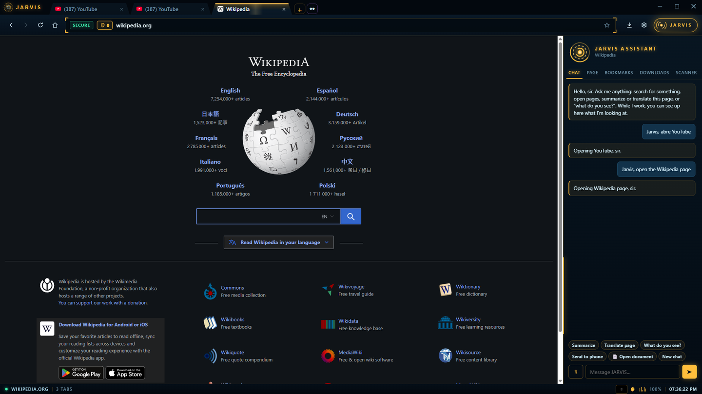
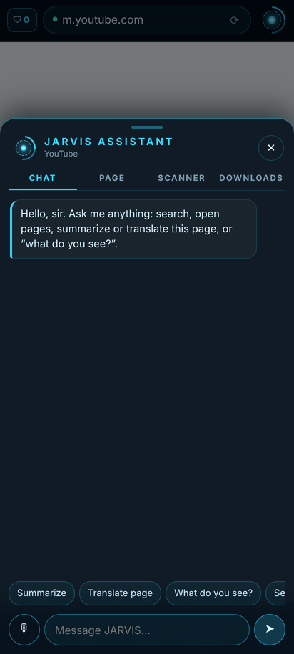
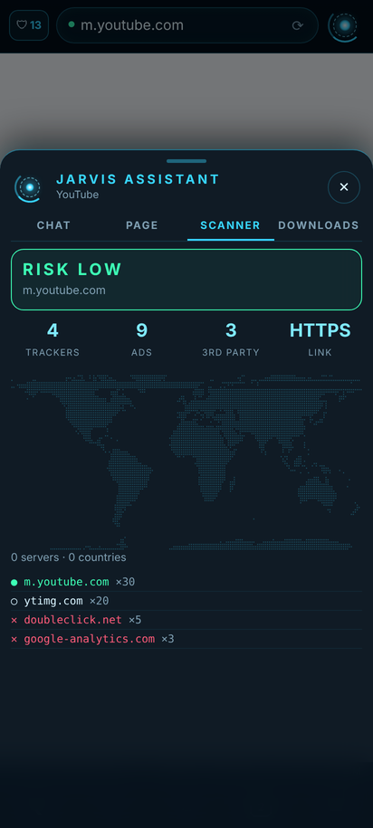
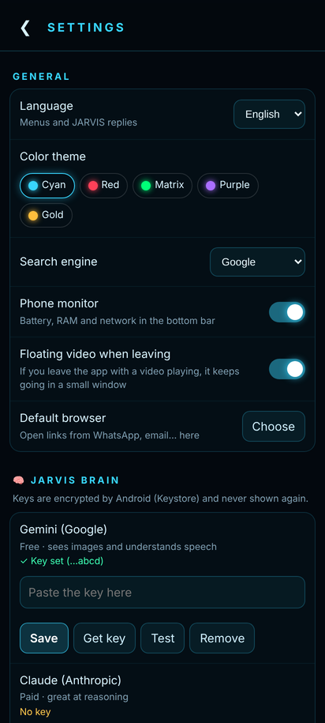

<div align="center">

# JARVIS Browser

**Un navegador con un asistente de IA dentro. Le hablas, y él navega por ti.**

[English](README.md) · **Español**

[](https://github.com/IV2S4/jarvis-browser/releases/latest)
[](https://github.com/IV2S4/jarvis-browser/releases/latest)



</div>

---

## ¿Qué es?

JARVIS Browser es un navegador web para **Windows** y **Android** con un asistente de inteligencia artificial integrado. Funciona como cualquier navegador (pestañas, favoritos, historial, descargas), pero además tiene a **JARVIS**: un asistente al que le puedes escribir o hablar y que **entiende la página que estás viendo**, la resume, la traduce, te dice qué hay en ella y hasta **maneja el navegador por ti**: abre páginas, hace clic, escribe y busca.

Todo con una interfaz estilo HUD futurista, bloqueador de anuncios, escáner de amenazas y un montón de herramientas más.

**Cada persona usa sus propias llaves de IA.** El navegador no trae llaves ni cuentas de nadie: tú pones las tuyas en Ajustes y se guardan **cifradas en tu propio equipo**. La de Gemini (Google) es gratis.

<div align="center">



</div>

---

## Índice

1. [Qué sabe hacer](#qué-sabe-hacer)
2. [Instalar en Windows](#instalar-en-windows)
3. [Instalar en Android](#instalar-en-android)
4. [Primeros pasos: poner tus llaves](#primeros-pasos-poner-tus-llaves)
5. [Cómo hablarle a JARVIS](#cómo-hablarle-a-jarvis)
6. [Atajos de teclado (PC)](#atajos-de-teclado-pc)
7. [Control con gestos (PC)](#control-con-gestos-pc)
8. [Privacidad: qué sale de tu equipo y qué no](#privacidad-qué-sale-de-tu-equipo-y-qué-no)
9. [Requisitos, limitaciones y problemas comunes](#requisitos-limitaciones-y-problemas-comunes)
10. [Construirlo tú mismo (código fuente)](#construirlo-tú-mismo-código-fuente)
11. [Licencia](#licencia)

---

## Qué sabe hacer

### 🧠 El asistente JARVIS

| Función | Qué hace |
|---|---|
| **Chat y voz** | Escríbele o pulsa 🎙 y háblale. Contesta por escrito y, si quieres, en voz alta. |
| **"Jarvis, abre YouTube"** | Abre páginas por voz: escribe la dirección arriba, en la barra, y la abre. Conoce unas 80 páginas populares, entiende direcciones dichas ("github punto com") y busca dentro de sitios ("busca recetas de pollo en YouTube"). Es instantáneo y no gasta IA. |
| **Piloto automático** | Pídele tareas de varios pasos ("busca el precio de X en tres tiendas y hazme una tabla"). JARVIS abre páginas, hace clic, escribe, lee y toma fotos de la pantalla; ves cada paso en vivo y al final te da un informe. |
| **"¿Qué ves?"** | Recorre la página parte por parte, con una foto de cada parte, y te cuenta lo que hay. |
| **Resumir** | Resume la página o **el video de YouTube** que estás viendo. |
| **Traducir** | Traduce la página entera, y pone **subtítulos traducidos en YouTube** si el video está en otro idioma. |
| **Hablar con PDFs y documentos** | Abre un PDF, un Word o un texto (Ctrl+O) y pregúntale: resumen, puntos clave, cuestionario… |
| **Dictado en cualquier caja** | Ctrl+Mayús+D en cualquier campo de cualquier página: hablas y JARVIS escribe. Puede escribir en otro idioma mientras dictas (hablas en español y se escribe en inglés). |
| **Voz siempre activa** | Di "Jarvis…" y tu orden sin tocar nada. La palabra "Jarvis" se detecta dentro de tu PC, sin internet. |
| **Memoria** | "Recuerda que prefiero respuestas cortas." JARVIS usa lo que le cuentas. Puedes ver y borrar cada recuerdo en Ajustes. |
| **Cualquier idioma** | Entiende lo que le digas en cualquier idioma y contesta en el idioma del navegador. |
| **Varias IAs** | Gemini (gratis), Claude y OpenAI. Eliges cuál va primero y, si una falla, prueba con las otras. |
| **Cerebro local (opcional)** | Puedes conectar un modelo en tu propia PC (llama.cpp / `llama-server`, por ejemplo Qwen) para que conteste sin internet o cuando se te acaben los créditos. |

### 🛡 Seguridad y privacidad

- **Bloqueador de anuncios y rastreadores** completo (listas EasyList y uBlock, motor de Ghostery).
- **Escáner de amenazas** en cada página: cuántos rastreadores y anuncios se bloquearon, con qué servidores habla la página, en qué países están (en un mapa) y un **nivel de riesgo**. Si una página parece una estafa, te avisa en rojo.
- **Escáner de descargas**: cada archivo que bajas pasa por Windows Defender, y opcionalmente por VirusTotal (solo se envía su huella, nunca el archivo).
- **Solo HTTPS**, **DNS seguro** (Quad9, frena páginas peligrosas conocidas), señales "no me rastrees" (DNT y GPC), bloqueo de ventanas emergentes y permisos por sitio (cámara, micrófono, ubicación).
- **Pestañas privadas** (Ctrl+Mayús+N) y opción de **borrar todo al cerrar**.
- **Tus llaves de IA van cifradas** (DPAPI de Windows en la PC, Keystore de Android en el teléfono) y cada llave solo se envía a su propio servicio.
- **Protección contra trampas en páginas web**: si una página tiene texto escondido que intenta darle órdenes a JARVIS, él lo trata como texto y no lo obedece.

### 🗂 Para el día a día

- Pestañas normales o **verticales**, **pantalla dividida** (Ctrl+Mayús+S), **video flotante** (Ctrl+Mayús+V) y **reabrir la pestaña cerrada** (Ctrl+Mayús+T).
- **Favoritos, historial y descargas** en el panel, y sugerencias de lo que ya visitaste al escribir en la barra.
- **Vigilante de precios**: "vigila esta página" y JARVIS la revisa cada hora y te avisa si baja el precio o cambia algo.
- **Mandar al teléfono**: manda la página que estás viendo a tu Telegram (con tu propio bot).
- **Importar de Chrome, Edge o Brave**: tus favoritos y tu historial con un clic.
- Lo puedes poner como **navegador predeterminado**.
- **Extensiones**: carga extensiones de Chrome descomprimidas, o scripts propios tipo Tampermonkey.
- **Actualizaciones automáticas** desde esta página de GitHub: cuando sale una versión nueva, se instala sola al cerrar el navegador.
- **Idiomas de la interfaz**: español, inglés, portugués, francés, alemán e italiano.

### 🖥 Cyber HUD

- **5 temas de colores** (dorado, cian, rojo, verde Matrix y morado), efectos holográficos y sonidos de interfaz muy suaves.
- **Monitor del sistema** en la barra de abajo: CPU, RAM, GPU (con temperatura) e internet en vivo.
- **Terminal de comandos** (Ctrl+K): `open youtube`, `search …`, `scan`, `trace google.com`, `sys`, `gaming on`… Escribe `help` para verlos todos.
- **Centro de mando**: una pantalla para tu segundo monitor con reloj, el orbe de JARVIS, CPU y GPU, la página actual con su mapa y las alertas.

### 🎮 Para gamers

- **Modo gaming automático**: al abrir un juego, las pestañas de fondo se duermen y el navegador libera CPU y RAM. El monitor y el cerebro local también se pausan.
- **"Jarvis, clip that"**: guarda la jugada con la repetición instantánea de NVIDIA o de la Xbox Game Bar y te la manda al teléfono.

### 📱 En Android

La versión del teléfono tiene casi todo lo anterior, acomodado para pantalla táctil:

- Pestañas normales y privadas, favoritos, historial, descargas y buscar en la página.
- JARVIS con chat y voz, **"Jarvis, abre YouTube"**, piloto automático, "¿qué ves?", resumir y traducir.
- Escáner de amenazas, bloqueador de anuncios y Safe Browsing de Google.
- **Video flotante** que sigue sonando, con botones ⏪ ⏯ ⏩ en la ventanita — desde el menú (▣) o solo al salir de la app, modo escritorio, zoom del texto, compartir y navegador predeterminado.
- Monitor del teléfono (batería, RAM, internet), terminal, vigilante de precios, Telegram, memoria, temas y el cerebro local de tu PC por WiFi.
- **Control con gestos** con la cámara de adelante del teléfono (☰ › Control con gestos para encenderlo y apagarlo).
- **Respaldo de ajustes** cifrado con tu propia clave, para pasar tus llaves y ajustes a otro teléfono.

<div align="center">

  

</div>

Todavía **solo en la PC**: voz siempre activa ("Jarvis…" sin tocar), dictado en las cajas de las páginas, hablar con PDFs, centro de mando, modo gaming y clips.

---

## Instalar en Windows

1. Entra en **[Releases](https://github.com/IV2S4/jarvis-browser/releases/latest)** y descarga **`Navegador-JARVIS-Setup.exe`**.
2. Ábrelo. Es muy probable que Windows muestre **"Windows protegió tu PC"**: el instalador todavía no tiene una firma de pago, y Windows avisa con todos los programas nuevos sin firma. Pulsa **"Más información" → "Ejecutar de todas formas"**.
3. Elige la carpeta (o deja la que viene) y pulsa **Instalar**. Se crea un acceso directo en el escritorio.
4. Al abrirlo por primera vez, sigue los [primeros pasos](#primeros-pasos-poner-tus-llaves).

**Actualizar:** no tienes que hacer nada. El navegador revisa esta página y, cuando hay una versión nueva, la descarga, comprueba que no esté dañada y la instala al cerrarlo. También puedes ir a Configuración → Acerca de → "Buscar actualización". Tus datos (llaves, favoritos, historial) no se tocan.

**Desinstalar:** Configuración de Windows → Aplicaciones → "Navegador JARVIS" → Desinstalar. Tus datos quedan en `C:\Users\<tú>\.config\jarvis\`; borra esa carpeta si quieres quitarlo todo.

## Instalar en Android

1. Desde el teléfono, entra en **[Releases](https://github.com/IV2S4/jarvis-browser/releases/latest)** y descarga el archivo **`JARVIS-Browser-x.x.x.apk`**.
2. Ábrelo. Android te pedirá permiso para **"instalar apps desconocidas"** desde tu navegador o tu app de archivos: actívalo solo para esa app.
3. Si Play Protect avisa de que es una "app desconocida", pulsa **"Instalar de todas formas"**. Sale ese aviso porque la app no viene de la Play Store.
4. Ábrela y sigue los [primeros pasos](#primeros-pasos-poner-tus-llaves).

**Actualizar:** descarga la APK nueva e instálala **encima** de la que tienes. No hace falta desinstalar y no se borra nada.

**Antes de desinstalar o cambiar de teléfono:** ve a Ajustes → 💾 **Respaldo de ajustes** y crea un respaldo. Al desinstalar, Android borra los datos de la app, y el respaldo es la forma de recuperarlos.

---

## Primeros pasos: poner tus llaves

JARVIS necesita al menos **una llave de IA** para pensar. Sin llaves, el navegador funciona igual, pero sin el asistente.

**Dónde ponerlas:**
- **PC:** ⚙ (arriba a la derecha) → **Cerebro de JARVIS**.
- **Android:** ☰ → **Ajustes** → **Cerebro de JARVIS**.

| Servicio | Precio | Dónde se consigue | Para qué sirve |
|---|---|---|---|
| **Gemini (Google)** ⭐ | **Gratis** (con límite diario) | [aistudio.google.com/apikey](https://aistudio.google.com/apikey) | Chat, ver fotos, entender tu voz y videos de YouTube. **Empieza por esta.** |
| **Claude (Anthropic)** | De pago, por uso | [console.anthropic.com](https://console.anthropic.com/settings/keys) | Muy bueno razonando y en tareas largas. No entiende audio. |
| **OpenAI (ChatGPT)** | De pago, por uso | [platform.openai.com/api-keys](https://platform.openai.com/api-keys) | Chat, fotos, voz y una voz de respuesta muy natural. |

Pega la llave, pulsa **Guardar** y luego **Probar**. Después la llave ya no se vuelve a mostrar: solo ves sus últimas 4 letras.

**Opcionales:**
- **Telegram** (para "mandar al teléfono", avisos y clips): en Telegram abre **@BotFather**, escribe `/newbot` y copia el token que te da. Pégalo en Ajustes → Telegram, escríbele cualquier cosa a tu bot y pulsa **Conectar**. Cada persona usa su propio bot.
- **VirusTotal** (PC, para revisar descargas con más de 70 antivirus): llave gratis en [virustotal.com](https://www.virustotal.com/gui/my-apikey).
- **Cerebro local**: si tienes `llama-server` (llama.cpp) con un modelo como Qwen, pon su dirección en Ajustes. Para usarlo desde el teléfono, arráncalo con `--host 0.0.0.0` y pon la IP de tu PC (por ejemplo `http://192.168.1.20:8080`).

---

## Cómo hablarle a JARVIS

Pulsa 🎙 en el chat (o en la PC, si activaste la voz siempre activa, di "Jarvis…"). Algunos ejemplos:

| Dices | JARVIS hace |
|---|---|
| "Jarvis, abre YouTube" / "llévame a GitHub" / "open Reddit" | Escribe la dirección en la barra y abre la página |
| "Busca recetas de pollo en YouTube" | Busca dentro de YouTube (también Google, Amazon, Wikipedia, Spotify, TikTok, Mercado Libre y eBay) |
| "Abre la página de la NASA" | Si no la conoce, entra directo al primer resultado |
| "¿Qué ves?" | Recorre la página parte por parte |
| "Resume esta página" / "resume este video" | Te da un resumen |
| "Traduce la página" | La traduce entera |
| "Busca vuelos baratos a Madrid en diciembre y compáralos" | Piloto automático: lo hace paso a paso |
| "Recuerda que mi equipo favorito es…" | Lo guarda en su memoria |
| "Manda esta página a mi teléfono" | Te la manda por Telegram |
| "Vigila el precio de esta página" | Te avisa si baja |
| "Jarvis, clip that" (PC) | Guarda la jugada |

---

## Atajos de teclado (PC)

| Atajo | Acción |
|---|---|
| Ctrl+T / Ctrl+W | Pestaña nueva / cerrar pestaña |
| Ctrl+Mayús+T | Reabrir la pestaña que cerraste |
| Ctrl+Mayús+N | Pestaña privada |
| Ctrl+Tab / Ctrl+Mayús+Tab | Pestaña siguiente / anterior |
| Ctrl+L | Ir a la barra de direcciones |
| Ctrl+F | Buscar en la página |
| Ctrl+D | Guardar en favoritos |
| Ctrl+J | Abrir o cerrar el panel de JARVIS |
| Ctrl+K | Terminal de comandos |
| Ctrl+O | Abrir un PDF, Word o texto de tu PC |
| Ctrl+Mayús+D | Dictar en la caja donde estás escribiendo |
| Ctrl+Mayús+S | Pantalla dividida |
| Ctrl+Mayús+V | Video flotante |
| Ctrl+H / Ctrl+, | Historial / Configuración |
| Ctrl+ + / Ctrl+ − / Ctrl+0 | Zoom |
| Alt+← / Alt+→ | Atrás / adelante |
| F5 · F11 · F12 | Recargar · pantalla completa · herramientas de desarrollador |

## Control con gestos (PC)

Actívalo en Configuración → Cyber HUD y después **pulsa la mano ✋ de la barra de abajo** cada vez que quieras usarlo: la cámara nunca se enciende sola. Usa la cámara de la PC (o la de tu celular conectado como cámara web). **Todo se procesa dentro de tu PC: ninguna imagen sale de ella.**

En **Android** funciona igual con la cámara de adelante del teléfono:

1. Toca ☰ › **Control con gestos**. La primera vez te pide permiso para la cámara y baja el detector de manos (7,5 MB).
2. Pon la mano a unos 30–50 cm de la cámara de adelante, con la palma hacia ella y buena luz.
3. El chip ✋ de la barra de abajo se pone **verde** y muestra la forma que ve (✋ ☝ ✌ ✊ 👍 🤏) cuando reconoce tu mano.
4. Para apagarlo, toca el chip ✋ o vuelve a ☰ › Control con gestos. Si sales de la app, la cámara se apaga sola.

Consejo: empieza con ✌ y ☝ (bajar y subir), que son los más fáciles; para cambiar de pestaña necesitas tener al menos dos abiertas.

| Gesto | Acción |
|---|---|
| 👉 / 👈 Mover la mano de lado | Pestaña siguiente / anterior |
| ✋ Palma abierta quieta (1 s) | Pausar / seguir el video |
| ☝ Un dedo arriba | Subir la página |
| ✌ Dos dedos | Bajar la página |
| 👍 Pulgar arriba (1 s) | Llamar a JARVIS (micrófono) |
| ✊ Puño cerrado (1,5 s) | Cerrar la pestaña |
| 🤏 Pellizco y subir o bajar la mano | Zoom más / menos |

---

## Privacidad: qué sale de tu equipo y qué no

El navegador **no tiene telemetría**: no manda estadísticas, ni lo que haces, a nadie (tampoco al autor). Lo único que sale de tu equipo es lo que hace falta para cada función:

| Destino | Qué se envía | Cuándo |
|---|---|---|
| La IA que elijas (Google, Anthropic u OpenAI) | Tu pregunta, y el texto o una foto de la página si la pregunta lo necesita | Solo cuando le hablas a JARVIS |
| Tu propio bot de Telegram | La página o el clip que mandas | Solo cuando lo pides |
| VirusTotal (opcional) | La huella (hash) del archivo descargado, nunca el archivo | Al terminar una descarga |
| ip-api.com | Las IP de los servidores de la página, para dibujar el mapa | Al abrir el escáner |
| Quad9 (opcional) | Los nombres de las páginas que visitas (DNS seguro) | Si activas el DNS seguro |
| DuckDuckGo | El nombre de una página que JARVIS no conoce | Solo con "abre la página de…" |
| GitHub | Una consulta de "¿hay versión nueva?" | Al abrir el navegador y cada 30 minutos |

Tus llaves, tu historial, tus favoritos y la memoria de JARVIS **se quedan en tu equipo**. En la PC están en `C:\Users\<tú>\.config\jarvis\`, y las llaves van cifradas.

---

## Requisitos, limitaciones y problemas comunes

**Requisitos**
- **PC:** Windows 10 u 11 de 64 bits, unos 500 MB libres. Para la voz, un micrófono; para los gestos, una cámara.
- **Android:** Android 11 o más nuevo.
- **Para el asistente:** internet y al menos una llave de IA (la de Gemini es gratis). Sin llaves, el navegador funciona igual, pero sin JARVIS.

**Lo que no hace (todavía)**
- No hay versión para **Mac, iPhone ni Linux** (en Linux puede funcionar desde el código, pero no hay instalador).
- No guarda contraseñas ni sincroniza entre equipos. Las contraseñas de Chrome no se importan: Chrome las tiene bloqueadas para sí mismo.
- Las extensiones de Chrome no se instalan desde la Chrome Web Store: se cargan descomprimidas desde la carpeta `Documentos/JARVIS Browser/Extensions`.
- El instalador de Windows no está firmado, por eso Windows avisa la primera vez.

**Problemas comunes**

| Problema | Solución |
|---|---|
| Windows dice "Windows protegió tu PC" | "Más información" → "Ejecutar de todas formas". Es por la falta de firma. |
| Android dice "App no instalada" o "conflicto con un paquete existente" | Tienes instalada una versión firmada distinta (por ejemplo, una que compilaste tú). Crea un respaldo, desinstálala e instala esta. |
| JARVIS dice "sin créditos", "límite" o "cuota" | Se acabó el límite gratis de Gemini por hoy o no tienes saldo en esa IA. Pon otra llave o espera al día siguiente. JARVIS prueba solo con las otras IAs que tengas. |
| JARVIS no me entiende la voz | La voz necesita la llave de Gemini u OpenAI (Claude no entiende audio). Revisa también el permiso del micrófono. |
| No me llegan cosas a Telegram | Escríbele algo a tu bot y vuelve a pulsar "Conectar" en Ajustes. |
| El teléfono no llega al cerebro local de la PC | Deben estar en el mismo WiFi y `llama-server` tiene que arrancar con `--host 0.0.0.0`. Revisa también el firewall de Windows. |

---

## Construirlo tú mismo (código fuente)

```
desktop/          Versión de Windows (Electron)
  app/            El navegador: main.js, preload, lib/ (funciones) y ui/ (interfaz)
  idiomas/        Traducciones de la interfaz
  inicio/         Página de inicio
  construir.ps1   Arma el instalador
android/          Versión de Android (Java, WebView)
docs/             Imágenes de este README
```

**Windows:** necesitas [Node.js](https://nodejs.org) (versión LTS) y PowerShell. Abre PowerShell en la carpeta `desktop` y ejecuta:

```powershell
powershell -ExecutionPolicy Bypass -File construir.ps1
```

La primera vez descarga Electron y electron-builder (unos 200 MB). El instalador queda en `desktop/salida/`.

**Android:** necesitas [Android Studio](https://developer.android.com/studio) (trae Java y el SDK). Abre la carpeta `android` en Android Studio, o en una terminal:

```bash
cd android
./gradlew assembleDebug      # en Windows: gradlew.bat assembleDebug
```

La APK queda en `android/app/build/outputs/apk/debug/`. Para una versión *release* firmada, crea tu propio keystore y un archivo `~/.config/jarvis/android/firma.properties` con `archivo=`, `alias=` y `clave=`. Ojo: una APK firmada por ti no se puede instalar encima de la oficial (y al revés).

El código y los comentarios están en español.

---

## Licencia

**Gratis para uso personal y sin fines comerciales.** Puedes usarlo, estudiarlo y modificarlo para ti. **No puedes venderlo** ni usarlo para ganar dinero sin permiso del autor. Los detalles están en [LICENSE.md](LICENSE.md) ([PolyForm Noncommercial 1.0.0](https://polyformproject.org/licenses/noncommercial/1.0.0)).

Usa con gratitud el trabajo de otros proyectos: Electron y Chromium, el motor de bloqueo de Ghostery, las listas EasyList y uBlock, Vosk (voz sin internet), MediaPipe (gestos), unpdf, mammoth y sql.js.

JARVIS Browser es un proyecto independiente de su autor y no está afiliado a ninguna empresa ni estudio.
