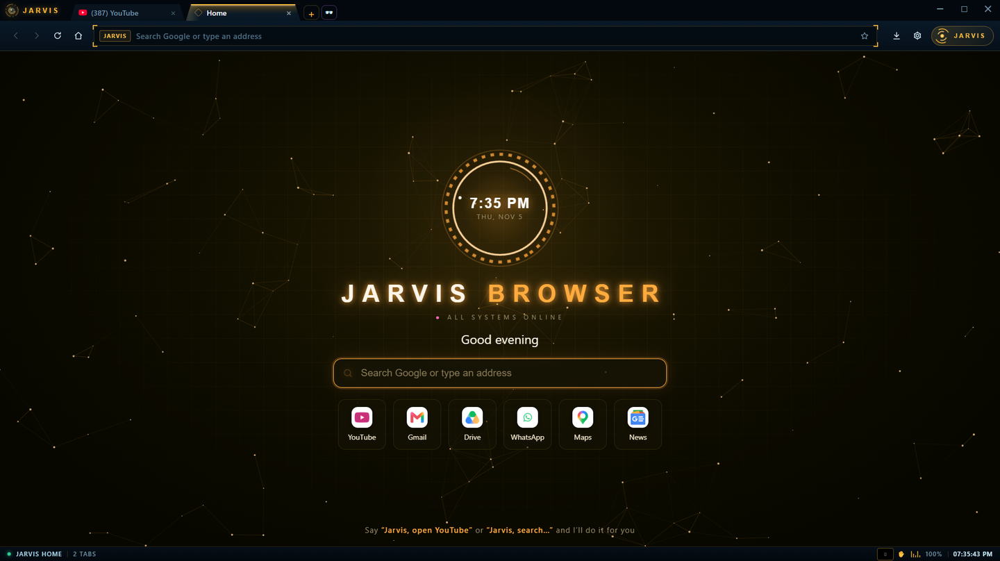
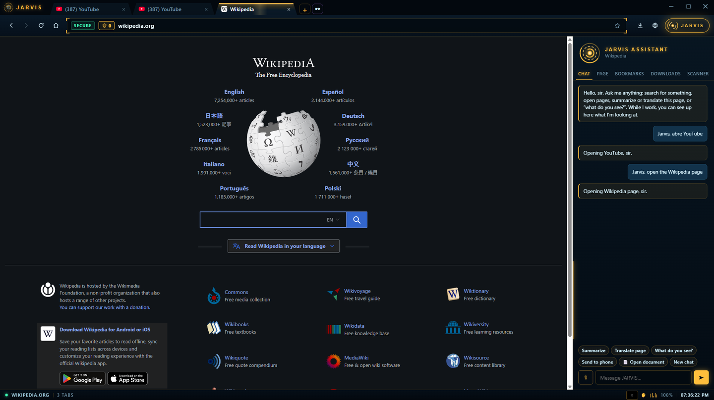
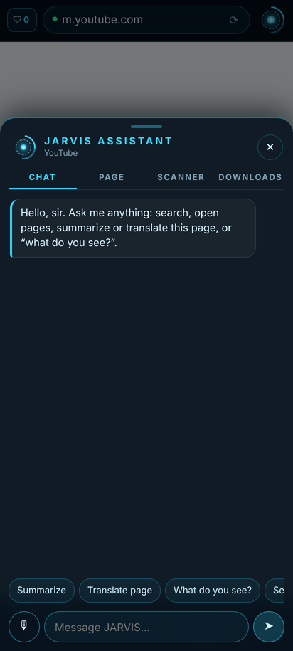
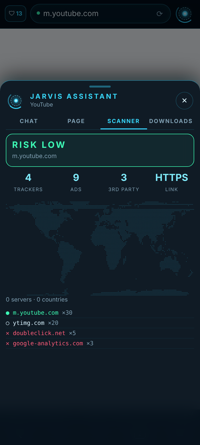
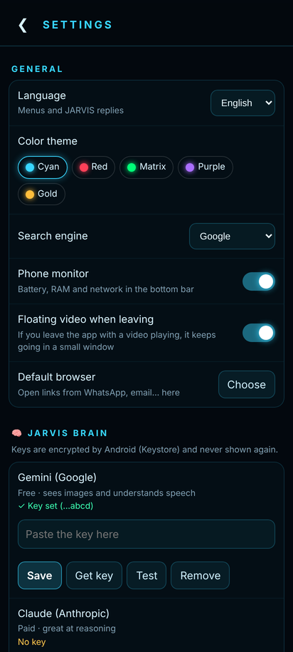

<div align="center">

# JARVIS Browser

**A web browser with an AI assistant built in. Talk to it, and it browses for you.**

**English** · [Español](README.es.md)

[](https://github.com/IV2S4/jarvis-browser/releases/latest)
[](https://github.com/IV2S4/jarvis-browser/releases/latest)



</div>

---

## What is it?

JARVIS Browser is a web browser for **Windows** and **Android** with a built-in AI assistant. It works like any browser (tabs, bookmarks, history, downloads), but it also has **JARVIS**: an assistant you can type or talk to that **understands the page you're on**. It summarizes and translates the page, tells you what's on it, and can even **drive the browser for you**: open pages, click, type and search.

All of it comes with a futuristic HUD interface, an ad blocker, a threat scanner and many more tools.

**Everyone uses their own AI keys.** The browser ships with no keys or accounts: you add yours in Settings and they're stored **encrypted on your own device**. Gemini (Google) has a free tier.

<div align="center">



</div>

---

## Contents

1. [What it can do](#what-it-can-do)
2. [Install on Windows](#install-on-windows)
3. [Install on Android](#install-on-android)
4. [Getting started: add your keys](#getting-started-add-your-keys)
5. [Talking to JARVIS](#talking-to-jarvis)
6. [Keyboard shortcuts (PC)](#keyboard-shortcuts-pc)
7. [Gesture control (PC)](#gesture-control-pc)
8. [Smart features](#smart-features)
9. [Privacy: what leaves your device](#privacy-what-leaves-your-device)
10. [Requirements, limitations and troubleshooting](#requirements-limitations-and-troubleshooting)
11. [Build it yourself](#build-it-yourself)
12. [License](#license)

---

## What it can do

### 🧠 The JARVIS assistant

| Feature | What it does |
|---|---|
| **Chat and voice** | Type, or tap 🎙 and talk. It replies in text and, if you want, out loud. |
| **"Jarvis, open YouTube"** | Opens sites by voice: it types the address in the bar and opens it. It knows about 80 popular sites, understands spoken addresses ("github dot com" in Spanish: "github punto com") and searches inside sites ("search chicken recipes on YouTube"). It's instant and uses no AI credits. |
| **Autopilot** | Give it multi-step tasks ("find the price of X in three stores and make me a table"). JARVIS opens pages, clicks, types, reads and takes screenshots; you see each step live and get a report at the end. |
| **"What do you see?"** | Walks through the page section by section, with a picture of each part, and tells you what's there. |
| **Summarize** | Summarizes the page, or **the YouTube video** you're watching. |
| **Translate** | Translates the whole page, and adds **translated YouTube subtitles** when a video is in another language. |
| **Chat with PDFs and documents** | Open a PDF, Word or text file (Ctrl+O) and ask about it: summary, key points, a quiz… |
| **Dictation in any text box** | Ctrl+Shift+D in any field on any page: speak and JARVIS types. It can translate while you dictate (speak Spanish, write English). |
| **Always-on voice** | Say "Jarvis…" and your command, hands-free. The word "Jarvis" is detected on your PC, offline. |
| **Memory** | "Remember that I prefer short answers." JARVIS uses what you tell it. You can see and delete each memory in Settings. |
| **Any language** | Understands any language and replies in the browser's language. |
| **Several AIs** | Gemini (free tier), Claude and OpenAI. You choose which goes first; if one fails, it tries the others. |
| **Local brain (optional)** | Connect a model running on your own PC (llama.cpp `llama-server`, e.g. Qwen) to answer offline or when you run out of credits. |

### 🛡 Security and privacy

- **Full ad and tracker blocker** (EasyList and uBlock lists, Ghostery engine).
- **Threat scanner** on every page: trackers and ads blocked, which servers the page talks to and where they are (on a map), and a **risk level**. If a page looks like a scam, you get a red alert.
- **Download scanner**: every file goes through Windows Defender, and optionally VirusTotal (only the file's hash is sent, never the file).
- **HTTPS-only**, **secure DNS** (Quad9 blocks known dangerous sites), Do Not Track and Global Privacy Control, popup blocking and per-site permissions (camera, microphone, location).
- **Private tabs** (Ctrl+Shift+N) and an option to **clear everything on exit**.
- **Your AI keys are encrypted** (Windows DPAPI on PC, Android Keystore on the phone) and each key is only ever sent to its own service.
- **Prompt-injection protection**: if a page hides text that tries to give JARVIS orders, it treats it as plain text and ignores it.

### 🗂 Everyday tools

- Normal or **vertical tabs**, **split screen** (Ctrl+Shift+S), **picture-in-picture video** (Ctrl+Shift+V) and **reopen closed tab** (Ctrl+Shift+T).
- **Bookmarks, history and downloads** in the side panel, plus suggestions from your history as you type in the address bar.
- **Price watcher**: "watch this page", and JARVIS checks it every hour and tells you if the price drops or something changes.
- **Send to phone**: sends the current page to your Telegram (using your own bot).
- **Import from Chrome, Edge or Brave**: your bookmarks and history in one click.
- Can be set as your **default browser**.
- **Extensions**: load unpacked Chrome extensions, or your own Tampermonkey-style scripts.
- **Automatic updates** from this GitHub page: when a new version comes out, it installs itself when you close the browser.
- **Interface languages**: English, Spanish, Portuguese, French, German and Italian.

### 🖥 Cyber HUD

- **5 color themes** (gold, cyan, red, Matrix green and purple), holographic effects and subtle UI sounds.
- **System monitor** in the status bar: live CPU, RAM, GPU (with temperature) and network.
- **Command terminal** (Ctrl+K): `open youtube`, `search …`, `scan`, `trace google.com`, `sys`, `gaming on`… Type `help` for the full list.
- **Command center**: a screen for your second monitor with a clock, the JARVIS orb, CPU and GPU, the current page with its map, and alerts.

### 🎮 For gamers

- **Automatic gaming mode**: when a game starts, background tabs sleep and the browser frees CPU and RAM. The system monitor and local brain pause too.
- **"Jarvis, clip that"**: saves the play with NVIDIA's or the Xbox Game Bar's instant replay and sends it to your phone.

### 📱 On Android

The phone version has almost all of the above, adapted for touch:

- Normal and private tabs, bookmarks, history, downloads and find in page.
- JARVIS with chat and voice, **"Jarvis, open YouTube"**, autopilot, "what do you see?", summarize and translate.
- Threat scanner, ad blocker and Google Safe Browsing.
- **Floating video (picture-in-picture)** that keeps playing with sound, with ⏪ ⏯ ⏩ buttons in the floating window — from the menu (▣) or automatically when you leave the app, desktop mode, text zoom, sharing and default browser.
- Phone monitor (battery, RAM, network), terminal, price watcher, Telegram, memory, themes, and your PC's local brain over WiFi.
- **Gesture control** with the phone's front camera (☰ › Gesture control to turn it on and off).
- **Smart features**: auto pause, privacy guard, browser memory, live dubbing with native voices and "what is this?" with the back camera (see [Smart features](#smart-features)).
- **Settings backup** encrypted with your own password, to move your keys and settings to another phone.

<div align="center">

  

</div>

Still **PC only**: always-on voice (hands-free "Jarvis…"), dictation in page text boxes, chatting with PDFs, the command center, gaming mode and clips.

---

## Install on Windows

1. Go to **[Releases](https://github.com/IV2S4/jarvis-browser/releases/latest)** and download **`Navegador-JARVIS-Setup.exe`**.
2. Run it. Windows will probably show **"Windows protected your PC"**: the installer isn't signed with a paid certificate yet, and Windows warns about every new unsigned program. Click **"More info" → "Run anyway"**.
3. Choose a folder (or keep the default) and click **Install**. A desktop shortcut is created.
4. On first launch, follow [Getting started](#getting-started-add-your-keys).

**Updating:** nothing to do. The browser checks this page; when there's a new version it downloads it, verifies it isn't corrupted, and installs it when you close the browser. You can also go to Settings → About → "Check for updates". Your data (keys, bookmarks, history) is untouched.

**Uninstalling:** Windows Settings → Apps → "Navegador JARVIS" → Uninstall. Your data stays in `C:\Users\<you>\.config\jarvis\`; delete that folder to remove everything.

## Install on Android

1. On your phone, go to **[Releases](https://github.com/IV2S4/jarvis-browser/releases/latest)** and download **`JARVIS-Browser-x.x.x.apk`**.
2. Open it. Android will ask you to allow **"install unknown apps"** for your browser or file manager: allow it for that app only.
3. If Play Protect warns about an "unknown app", tap **"Install anyway"**. The warning appears because the app isn't from the Play Store.
4. Open it and follow [Getting started](#getting-started-add-your-keys).

**Updating:** download the new APK and install it **over** the one you have. No need to uninstall; nothing is erased.

**Before uninstalling or switching phones:** go to Settings → 💾 **Settings backup** and create a backup. Uninstalling makes Android delete the app's data, and the backup is how you get it back.

---

## Getting started: add your keys

JARVIS needs at least **one AI key** to think. Without keys, the browser still works, just without the assistant.

**Where to add them:**
- **PC:** ⚙ (top right) → **JARVIS brain**.
- **Android:** ☰ → **Settings** → **JARVIS brain**.

| Service | Price | Get a key | Good for |
|---|---|---|---|
| **Gemini (Google)** ⭐ | **Free** (daily limit) | [aistudio.google.com/apikey](https://aistudio.google.com/apikey) | Chat, images, understanding your voice and YouTube videos. **Start here.** |
| **Claude (Anthropic)** | Paid, per use | [console.anthropic.com](https://console.anthropic.com/settings/keys) | Excellent at reasoning and long tasks. No audio input. |
| **OpenAI (ChatGPT)** | Paid, per use | [platform.openai.com/api-keys](https://platform.openai.com/api-keys) | Chat, images, voice, and a very natural reply voice. |

Paste the key, click **Save**, then **Test**. After that the key is never shown again; you only see its last 4 characters.

**Optional:**
- **Telegram** (for "send to phone", alerts and clips): in Telegram, open **@BotFather**, send `/newbot` and copy the token it gives you. Paste it in Settings → Telegram, send any message to your bot and click **Connect**. Everyone uses their own bot.
- **VirusTotal** (PC, to check downloads with 70+ antivirus engines): free key at [virustotal.com](https://www.virustotal.com/gui/my-apikey).
- **Local brain**: if you run `llama-server` (llama.cpp) with a model such as Qwen, enter its address in Settings. To use it from your phone, start it with `--host 0.0.0.0` and use your PC's IP (e.g. `http://192.168.1.20:8080`).

---

## Talking to JARVIS

Tap 🎙 in the chat (or on PC, with always-on voice enabled, just say "Jarvis…"). Some examples:

| You say | JARVIS does |
|---|---|
| "Jarvis, open YouTube" / "take me to GitHub" / "go to Reddit" | Types the address in the bar and opens it |
| "Search chicken recipes on YouTube" | Searches inside YouTube (also Google, Amazon, Wikipedia, Spotify, TikTok, Mercado Libre and eBay) |
| "Open the NASA website" | If it doesn't know the site, it goes straight to the top result |
| "What do you see?" | Walks through the page section by section |
| "Summarize this page" / "summarize this video" | Gives you a summary |
| "Translate the page" | Translates the whole page |
| "Find cheap flights to Madrid in December and compare them" | Autopilot: does it step by step |
| "Remember that my favorite team is…" | Saves it to memory |
| "Send this page to my phone" | Sends it via Telegram |
| "Watch the price on this page" | Alerts you when it drops |
| "Jarvis, clip that" (PC) | Saves the play |

---

## Keyboard shortcuts (PC)

| Shortcut | Action |
|---|---|
| Ctrl+T / Ctrl+W | New tab / close tab |
| Ctrl+Shift+T | Reopen closed tab |
| Ctrl+Shift+N | Private tab |
| Ctrl+Tab / Ctrl+Shift+Tab | Next / previous tab |
| Ctrl+L | Focus the address bar |
| Ctrl+F | Find in page |
| Ctrl+D | Bookmark |
| Ctrl+J | Open or close the JARVIS panel |
| Ctrl+K | Command terminal |
| Ctrl+O | Open a PDF, Word or text file |
| Ctrl+Shift+D | Dictate into the text box you're typing in |
| Ctrl+Shift+S | Split screen |
| Ctrl+Shift+V | Picture-in-picture video |
| Ctrl+H / Ctrl+, | History / Settings |
| Ctrl++ / Ctrl+− / Ctrl+0 | Zoom |
| Alt+← / Alt+→ | Back / forward |
| F5 · F11 · F12 | Reload · full screen · developer tools |

## Gesture control (PC)

Turn it on in Settings → Cyber HUD, then **click the hand ✋ in the bottom bar** whenever you want to use it: the camera never turns on by itself. It uses your PC's camera (or your phone connected as a webcam). **Everything is processed on your PC; no image ever leaves it.**

On **Android** it works the same with the phone's front camera:

1. Tap ☰ › **Gesture control**. The first time it asks for camera permission and downloads the hand detector (7.5 MB).
2. Hold your hand about 30–50 cm (1–1.5 ft) from the front camera, palm facing it, in good light.
3. The ✋ chip in the bottom bar turns **green** and shows the shape it sees (✋ ☝ ✌ ✊ 👍 🤏) when it recognizes your hand.
4. To turn it off, tap the ✋ chip or go back to ☰ › Gesture control. Leaving the app turns the camera off automatically.

Tip: start with ✌ and ☝ (scroll down and up), they're the easiest; switching tabs needs at least two open tabs.

| Gesture | Action |
|---|---|
| 👉 / 👈 Move your hand sideways | Next / previous tab |
| ✋ Open palm held still (1 s) | Pause / play video |
| ☝ One finger up | Scroll up |
| ✌ Two fingers | Scroll down |
| 👍 Thumbs up (1 s) | Call JARVIS (microphone) |
| ✊ Closed fist (1.5 s) | Close tab |
| 🤏 Pinch, then move your hand up or down | Zoom in / out |
| ✊ then 🖐 Grab the page and throw it sideways opening your hand | Send the page to your phone (PC) |

---

## Smart features

Each one has its own switch in **Settings › 🚀 Smart features** (on PC: Settings, Cyber HUD and Smart features cards; on Android: Settings › Smart features).

| Feature | How to use it | Where |
|---|---|---|
| 💤 **Auto pause** | With the gesture camera on: get up and leave, and the video pauses; come back and it keeps playing. | PC and Android |
| 👁 **Privacy guard** | With the gesture camera on: if someone else appears looking at your screen, the page is covered (and the address bar blurred) until they leave. | PC and Android |
| 📲 **Throw to phone** | Close your hand ✊ as if grabbing the page and throw it sideways opening your hand 🖐: the page arrives on your phone via Telegram. | PC |
| 🧠 **Browser memory** | *"Jarvis, where did I see some red sneakers?"* — JARVIS finds the page by what it contained, not just its title. A short piece of each page's text is kept **only on your device** (never private tabs, banks, email or pages with password fields). Clearing history clears it too. | PC and Android |
| 🗣 **Live dubbing** | On a video: *"Jarvis, dub this video into Spanish"* (or the 🗣 button on Android). JARVIS turns on the translated subtitles and reads them aloud with a **native voice of that language**, lowering the original sound. *"Jarvis, stop dubbing"* to stop. If an ad is playing it starts by itself when the ad ends. Works with videos that have subtitles (almost all of YouTube, even automatic ones). | PC and Android |
| 📸 **Search what you see** | *"Jarvis, what is this?"* — on Android the back camera opens: point and tap 📸; on PC it takes a photo with your camera. JARVIS tells you what it is and searches for it. | PC and Android |

**Native voices for dubbing:** JARVIS never reads a language with a foreign accent. On Android it uses the phone's Google voices. On PC it uses the Windows voice for that language — install it for free in Windows Settings › Time & language › Speech › Add voices — or, if not installed, your OpenAI or Gemini key. Without any of these it shows only the translated subtitles.

---

## Privacy: what leaves your device

The browser has **no telemetry**: it sends no statistics and nothing about what you do to anyone, including the author. The only things that leave your device are what each feature needs:

| Destination | What is sent | When |
|---|---|---|
| Your chosen AI (Google, Anthropic or OpenAI) | Your question, plus the page's text or a screenshot when the question needs it | Only when you talk to JARVIS |
| Your own Telegram bot | The page or clip you send | Only when you ask |
| Your chosen AI | A camera photo, only when you ask "what is this?"; dubbing lines, only if you use your AI key for the voice | Only when you ask |
| VirusTotal (optional) | The downloaded file's hash, never the file | When a download finishes |
| ip-api.com | The IP addresses of the page's servers, to draw the map | When you open the scanner |
| Quad9 (optional) | The names of the sites you visit (secure DNS) | If you enable secure DNS |
| DuckDuckGo | The name of a site JARVIS doesn't know | Only for "open the … website" |
| GitHub | An "is there a new version?" check | On launch and every 30 minutes |

Your keys, history, bookmarks and JARVIS's memory **stay on your device**. On PC they live in `C:\Users\<you>\.config\jarvis\`, and the keys are encrypted.

---

## Requirements, limitations and troubleshooting

**Requirements**
- **PC:** 64-bit Windows 10 or 11, about 500 MB free. A microphone for voice, a camera for gestures.
- **Android:** Android 11 or newer.
- **For the assistant:** internet and at least one AI key (Gemini's is free). Without keys, the browser still works, just without JARVIS.

**What it doesn't do (yet)**
- No **Mac, iPhone or Linux** version (it may run from source on Linux, but there's no installer).
- No password manager and no sync between devices. Chrome passwords can't be imported: Chrome locks them to itself.
- Chrome extensions can't be installed from the Chrome Web Store; load them unpacked from `Documents/JARVIS Browser/Extensions`.
- The Windows installer isn't code-signed, so Windows warns you the first time.

**Troubleshooting**

| Problem | Fix |
|---|---|
| "Windows protected your PC" | "More info" → "Run anyway". It's because the installer isn't signed. |
| Android says "App not installed" or "conflicts with an existing package" | You have a version signed differently (e.g. one you built yourself). Make a backup, uninstall it, and install this one. |
| JARVIS says "no credits", "limit" or "quota" | You hit Gemini's free daily limit, or that AI account has no balance. Add another key or wait until tomorrow. JARVIS automatically tries your other AIs. |
| JARVIS doesn't understand my voice | Voice needs a Gemini or OpenAI key (Claude has no audio input). Also check microphone permission. |
| Nothing arrives on Telegram | Send your bot a message and click "Connect" in Settings again. |
| The phone can't reach the PC's local brain | Both must be on the same WiFi, and `llama-server` must start with `--host 0.0.0.0`. Also check Windows Firewall. |

---

## Build it yourself

```
desktop/          Windows version (Electron)
  app/            The browser: main.js, preloads, lib/ (features) and ui/ (interface)
  idiomas/        Interface translations
  inicio/         Start page
  construir.ps1   Builds the installer
android/          Android version (Java, WebView)
docs/             Images for this README
```

**Windows:** you need [Node.js](https://nodejs.org) (LTS) and PowerShell. Open PowerShell in the `desktop` folder and run:

```powershell
powershell -ExecutionPolicy Bypass -File construir.ps1
```

The first run downloads Electron and electron-builder (about 200 MB). The installer ends up in `desktop/salida/`.

**Android:** you need [Android Studio](https://developer.android.com/studio) (it includes Java and the SDK). Open the `android` folder in Android Studio, or from a terminal:

```bash
cd android
./gradlew assembleDebug      # on Windows: gradlew.bat assembleDebug
```

The APK ends up in `android/app/build/outputs/apk/debug/`. For a signed *release* build, create your own keystore and a `~/.config/jarvis/android/firma.properties` file with `archivo=`, `alias=` and `clave=` (file, alias, password). Note: an APK you sign yourself can't be installed over the official one (and vice versa).

The source code and its comments are in Spanish.

---

## License

**Free for personal, non-commercial use.** You may use, study and modify it for yourself. **You may not sell it** or use it to make money without the author's permission. Details in [LICENSE.md](LICENSE.md) ([PolyForm Noncommercial 1.0.0](https://polyformproject.org/licenses/noncommercial/1.0.0)).

Built with gratitude on Electron and Chromium, the Ghostery ad-blocking engine, the EasyList and uBlock lists, Vosk (offline voice), MediaPipe (gestures), unpdf, mammoth and sql.js.

JARVIS Browser is an independent project by its author and is not affiliated with any company or studio.
